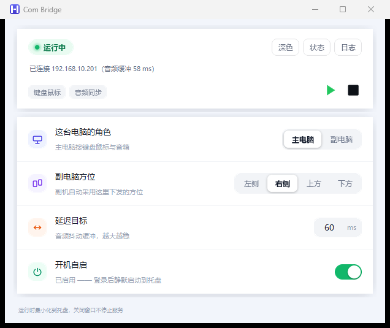
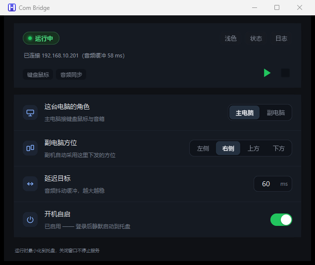

# Com Bridge

一套键盘鼠标控制两台 Windows 电脑，并把副电脑的声音汇到主电脑一起播放。

不用 KVM 切换器，也不用在两台机器之间反复换手。光标推到屏幕边缘就进入另一台电脑；
副电脑上播放的任何声音，都从主电脑的音箱出来。

  
  

## 它解决什么问题

桌面上有两台 Windows 电脑时（比如一台台式主机 + 一台笔记本），常见做法各有各的别扭：

- **摆两套键鼠** —— 桌面线材乱，操作时频繁换手
- **用 KVM 切换器** —— 每次切换黑屏一两秒，且大多不能把声音一起带过来
- **只靠远程桌面** —— 延迟高、画面被压缩，看视频听音乐不合适

Com Bridge 把「输入」和「声音」一起解决：一套键鼠跨两台，两边声音从同一个音箱出。

## 适合这些场景

- **台式机 + 笔记本双机办公** —— 一套键鼠，光标跨屏即切换
- **一台玩游戏、一台看视频** —— 两边声音统一到一副耳机或音箱
- **两台机器共用一套音响** —— 副机不必单独接音箱
- **没有 KVM、但需要频繁跨机操作**
- **需要跨机复制粘贴文字、截图或文件**

## 不适合

- **竞技游戏** —— 音频有约 60ms 的固定缓冲，射击类能感觉出来；游戏声音建议留在本机
- **公网或不可信网络** —— 传输未加密，只适合自己的局域网
- **macOS / Linux** —— 仅支持 Windows
- **传画面** —— 它搬键鼠、剪贴板（文字/图片/文件）和音频，但不做屏幕串流

## 功能

### 一套键鼠控制两台

设定主副角色后，把光标推到主电脑屏幕的指定边缘（左 / 右 / 上 / 下可配），就进入副电脑；
推回来自动返回。

键盘全键、鼠标左右键与中键、侧键、滚轮（含横向滚轮）都能带过去，
复制粘贴、切窗口、按快捷键这些操作在副电脑上照常。

### 副电脑的声音汇到主电脑

副电脑的系统声音（播放器、浏览器、会议软件）实时送到主电脑，与主电脑自己的声音
一起从主电脑扬声器播出。副电脑本地会自动静音，避免两边声音错开叠在一起。

### 剪贴板互通（文字 / 图片 / 文件）

在一台机器上复制，到另一台直接粘贴，双向都行：

- **文字** —— 纯文本与网页富文本（HTML），跨机保留格式
- **图片** —— 截图、画图板里的图，粘贴到对面直接可用；同时给出 PNG 与标准
  位图两种格式，新老程序都能粘
- **文件与文件夹** —— 在资源管理器里复制，到对面 `Ctrl+V` 即可落盘；
  文件夹会连目录结构一起还原（单次上限 16GB，接收目录保留最近 30 批）。
  传输过程中日志里会显示进度与速度，点停止即中止

### 常驻托盘

关窗口只是隐藏，服务继续跑。托盘图标用颜色表达状态：
**绿点**已连接、**黄点**等待连接、**无点**未启动。

### 开机自启（可选）

勾选后随 Windows 登录静默启动到托盘，不弹窗、不需要管理员权限。
需要以管理员权限运行（例如控制提权窗口）时，可以另外用「开机自启（管理员）」
建一个登录计划任务 —— 这就是 Windows 上"服务级自启"的等价做法
（真正的服务跑在 Session 0，拿不到桌面输入与托盘，做不了这件事）。

### 发现新版本

启动后会在后台查一次 GitHub Release（6 小时最多一次，失败静默）。有新版本时
窗口底部的提示会变成可点击的下载链接，不再需要自己去翻仓库。

### 随时收回控制权

光标进了副电脑想立刻抢回来，按 `Ctrl + Alt + Esc`，控制权立即回本机。

## 开始使用

两台电脑各做一遍：

1. 到 [Releases](https://github.com/corvofiox/com-bridge/releases) 下载 `com-bridge-gui.exe`，
   放到任意目录即可，无需安装
2. 双击运行。首次可能被 SmartScreen 拦一下，点「更多信息 → 仍要运行」
3. **主电脑**：选「主电脑」，设置副电脑在屏幕的哪一侧
4. **副电脑**：选「副电脑」，填主电脑的 IP（在主电脑上运行 `ipconfig` 查看）
5. 两边点 ▶ 启动

连上之后主电脑会显示「已连接 …」，播放三角变绿；把光标推到配置的那一侧边缘就能进副电脑。

> 两台电脑需在同一局域网，并在防火墙放行相应端口。

## 系统要求

- Windows 10 1809+ / Windows 11，64 位
- 两台电脑处于同一局域网（或可直接互通）
- 键盘鼠标与音箱接在**主电脑**上；副电脑无需额外外设

---

实现细节、设计取舍与排障记录见 **[TECHNICAL.md](TECHNICAL.md)**。

## 许可

本项目为个人自用工具，未附带开源许可证。
